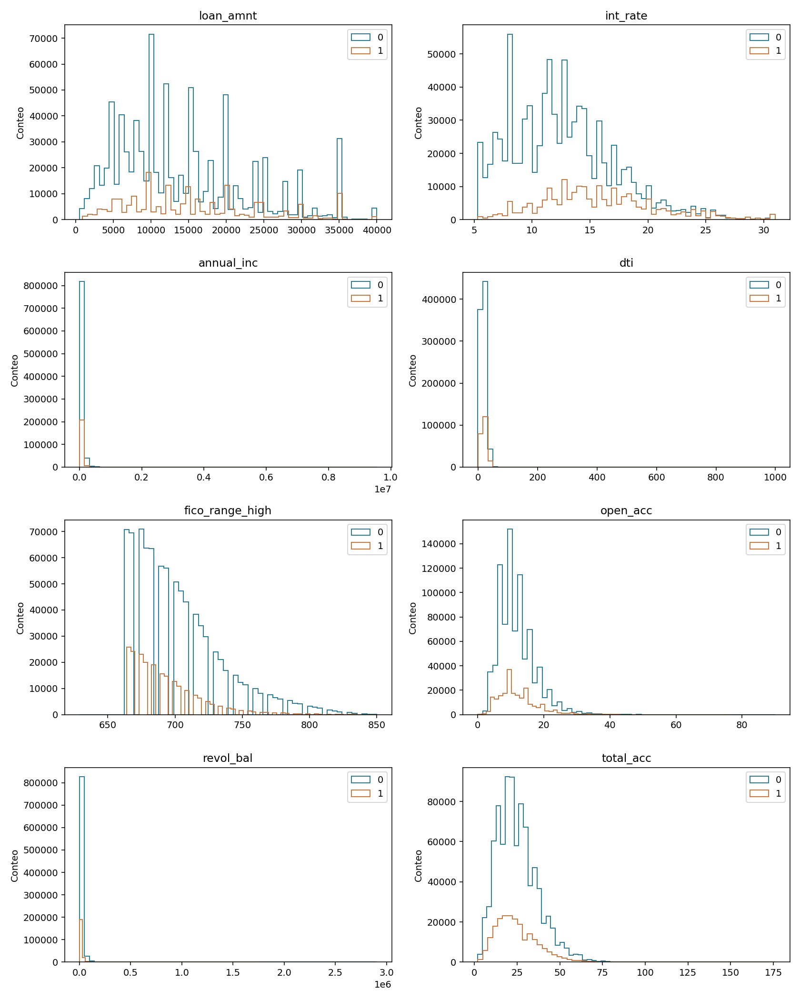
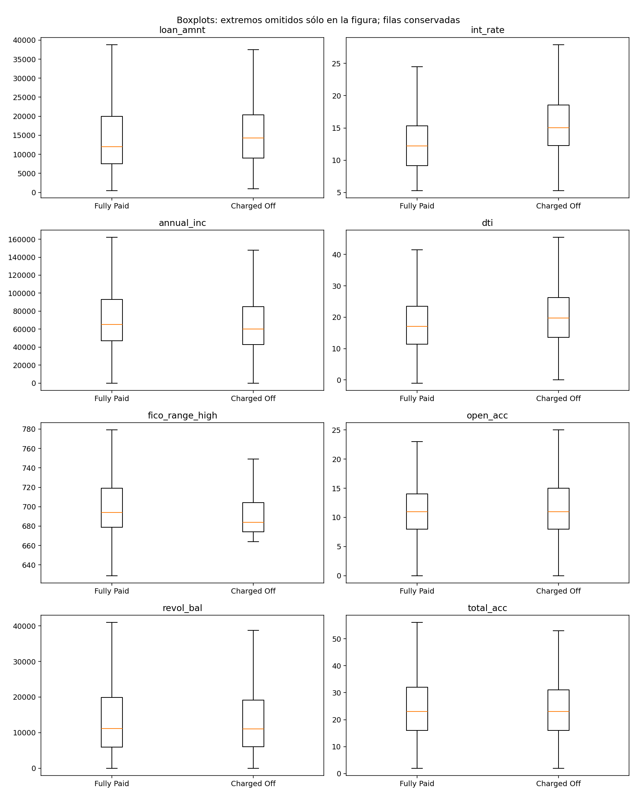
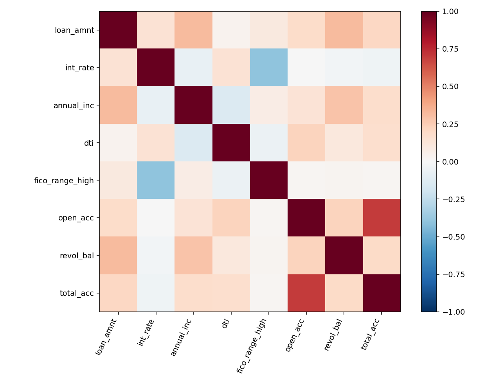
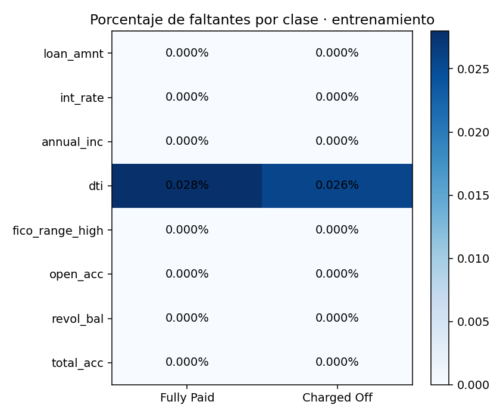
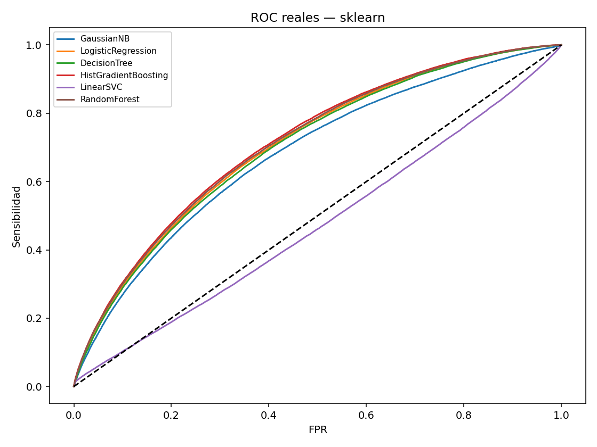
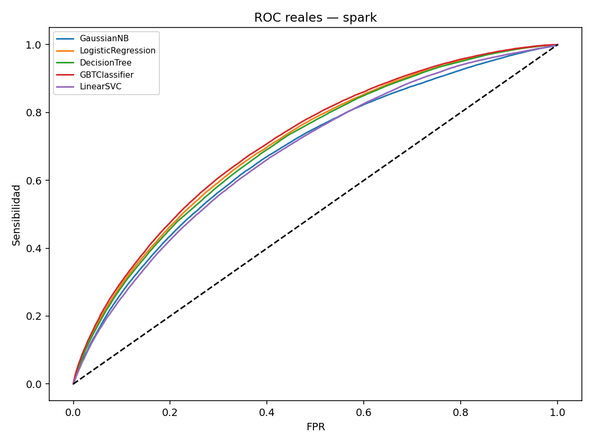

# Tarea 1 — Evaluación de modelos y riesgo crediticio

Andrés Duarte Chaves · Maestría en Ingeniería Biomédica · Dr. Lihki Rubio.
Revisión del 17 de octubre de 2026. **Ejecución parcial: 11 de 12 modelos completados. No se afirma cumplimiento completo.**

Esta versión sustituye la tabla manual y la ROC aproximada de Spark de la entrega anterior.
Cada resultado mostrado procede de una ejecución guardada. El historial Git conserva la versión previa.
La ejecución de Random Forest de Spark se interrumpió tras una limpieza del directorio temporal
y la pérdida de conexión con Java. La causa exacta de la caída de Java no está confirmada.
Se reconstruyen los modelos completados con sus parámetros guardados y se contrastan sus métricas,
sin reemplazar las búsquedas de CV originales. No hay resultados inventados para el modelo pendiente.

## Datos y objetivo

CSV real completo recuperado de ML_PROYECTOS en Archivo.zip, de 1,675,133,810 bytes.
SHA-256: `3eae03c28fd9d2e8a076ebeb73507e8d4d0f44d90500decdb0936e0933d1f36a`. No se usa el CSV sintético de la otra carpeta.
Se incluyen los 1,345,310 préstamos con estado terminal Fully Paid (0) o Charged Off (1).
Los demás estados se excluyen por la definición del objetivo; no se reclasifican como pagos exitosos.
No se realiza muestreo del entrenamiento supervisado. Se leen las 13 variables preespecificadas,
además del estado; la proyección de columnas no reduce el número de filas.

La tarea clasifica el desenlace observado entre préstamos aprobados. No representa todas las
solicitudes de crédito ni prueba causalidad. Tasa y grado de préstamo ya incorporan decisiones
de originación, por lo que el escenario es posterior a su asignación, no anterior a la oferta.
El identificador es de fila, no confirma independencia por prestatario. Una partición aleatoria
no evalúa cambios temporales; esa limitación afecta también los contrastes de independencia.

## Partición y reproducibilidad

Train: 1,076,248; test: 269,062. Semilla 42, estratificación 80/20.
Los IDs y los tres folds se guardan antes del EDA; ambos motores usan exactamente esa asignación.
El archivo canónico resuelve la discrepancia previa de una fila entre lectores. Las transformaciones
se aprenden de nuevo en cada fold y en el ajuste final sólo con entrenamiento.
Mediana numérica, Missing para categorías ausentes y one-hot con categorías de entrenamiento.
En los modelos lineales se estandarizan sólo las variables numéricas; las categorías mantienen
codificación binaria. sklearn usa varianza poblacional y Spark muestral al escalar: diferencia pequeña,
pero no se presentan transformaciones idénticas bit a bit. Spark reserva una categoría desconocida
adicional por variable; sklearn ignora categorías desconocidas con ceros. Esas columnas constantes
pueden afectar el muestreo de características de RF, por lo que tampoco se presume identidad algorítmica.

## Hardware y costos

Límite efectivo 8 GiB, cuota de 8 CPU; modelos con hasta 4 hilos. Spark local[4], driver 4 GiB y
16 particiones. Es una ejecución local, no una prueba de escalabilidad multinodo.
Spark se inició mientras scikit-learn continuaba con SVM y RF, con hasta cuatro hilos por motor.
Los tiempos concurrentes pueden verse afectados por memoria y carga compartida: **no se concluye
superioridad de velocidad entre bibliotecas**. Las métricas predictivas usan los mismos IDs y folds.
GridSearchCV usa un estimador compuesto sin Pipeline que aprende transformaciones en cada fit.
La búsqueda usa una tarea simultánea salvo SVM (dos hilos de búsqueda compartiendo memoria); RF usa 4 hilos.
SVM usa hinge, max_iter=2000 y tol=1e-3. Tras el escalado numérico se normaliza
a norma L2 el vector completo de cada fila, igual en ambos motores, para limitar problemas
numéricos de observaciones extremas. No se descartan filas. Esta transformación cambia la geometría
y reduce información sobre magnitud absoluta; no se presenta como una operación neutra.
La decisión se tomó tras detectar no convergencia en CV, por lo que esta CV exploratoria no es anidada. Se registra cada ajuste de scikit-learn en svc_convergence.jsonl.
Spark usa maxIter=1000 y tol=1e-6; no se conservó su historial interno de optimización,
por lo que no se afirma equivalencia de tolerancias ni convergencia interna verificada de Spark.
La primera búsqueda con 10000 iteraciones se interrumpió por costo antes de obtener resultados;
su tiempo no se atribuye a la ejecución completada. Un ajuste que llegue al límite no demuestra convergencia.
Spark utiliza ParamGridBuilder y CrossValidator de tres folds, con vectores materializados y
persistidos dentro de cada fold. Los tiempos CV incluyen transformaciones y ajuste final;
lectura, inferencia y transferencia de predicciones se reportan por separado cuando aplican.
No deben sumarse de nuevo los tiempos parciales de preprocesamiento que ya están incluidos en fit.

HistGradientBoosting sustituye a GradientBoosting de sklearn por costo de cómputo, como permite
la guía actual. Usa 50/100 iteraciones, profundidad 3/5, tasa 0,1, sin parada temprana ni límite de
hojas adicional. Spark usa GBT; la clave HistGradientBoosting en los nombres de archivo identifica
la familia emparejada, no una implementación de HistGradientBoosting en Spark. HistGradientBoosting usa 255 bins y Spark 64: los algoritmos no son
idénticos. RF y árboles también difieren en cortes y convenciones internas. GaussianNB usa
estabilización propia de cada biblioteca. La correspondencia C–regParam no demuestra equivalencia
numérica exacta; se calcula C con el número de filas del fit de cada fold.

## Resultados calculados

| framework   | implementation                 | cv_auc   | cv_sd   | roc_auc   | accuracy   | precision   | recall   | f1      | fit_cv_seconds   | predict_seconds   |
|:------------|:-------------------------------|:---------|:--------|:----------|:-----------|:------------|:---------|:--------|:-----------------|:------------------|
| sklearn     | GaussianNB                     | 0.68202  | 0.00030 | 0.68142   | 0.79053    | 0.43416     | 0.16255  | 0.23654 | 8.26008          | 0.27952           |
| sklearn     | LogisticRegression             | 0.70729  | 0.00038 | 0.70723   | 0.80167    | 0.53423     | 0.05057  | 0.09239 | 34.76182         | 0.19275           |
| sklearn     | DecisionTreeClassifier         | 0.70095  | 0.00029 | 0.70282   | 0.80113    | 0.51188     | 0.08143  | 0.14051 | 72.45315         | 0.21205           |
| sklearn     | HistGradientBoostingClassifier | 0.71522  | 0.00017 | 0.71557   | 0.80342    | 0.56413     | 0.06706  | 0.11987 | 98.39458         | 0.91715           |
| sklearn     | LinearSVC                      | 0.53225  | 0.03558 | 0.47386   | 0.80037    | 0.00000     | 0.00000  | 0.00000 | 214.09509        | 0.25095           |
| sklearn     | RandomForestClassifier         | 0.71114  | 0.00015 | 0.71157   | 0.80281    | 0.56236     | 0.05507  | 0.10032 | 443.25238        | 1.75457           |
| spark       | NaiveBayes                     | 0.68209  | 0.00030 | 0.68152   | 0.79078    | 0.43496     | 0.16069  | 0.23468 | 67.69541         | 2.30621           |
| spark       | LogisticRegression             | 0.70732  | 0.00038 | 0.70725   | 0.80167    | 0.53448     | 0.05021  | 0.09180 | 172.15651        | 1.89129           |
| spark       | DecisionTreeClassifier         | 0.70090  | 0.00030 | 0.70198   | 0.80103    | 0.51279     | 0.06604  | 0.11701 | 135.70129        | 2.05290           |
| spark       | GBTClassifier                  | 0.71420  | 0.00032 | 0.71490   | 0.80332    | 0.55151     | 0.07903  | 0.13825 | 976.36854        | 2.53927           |
| spark       | LinearSVC                      | 0.64065  | 0.01687 | 0.67995   | 0.80037    | 0.00000     | 0.00000  | 0.00000 | 224.25312        | 1.80275           |

### Matrices de confusión a corte fijo

| framework   | model                | tn     | fp    | fn    | tp   |
|:------------|:---------------------|:-------|:------|:------|:-----|
| sklearn     | GaussianNB           | 203971 | 11379 | 44981 | 8731 |
| sklearn     | LogisticRegression   | 212982 | 2368  | 50996 | 2716 |
| sklearn     | DecisionTree         | 211179 | 4171  | 49338 | 4374 |
| sklearn     | HistGradientBoosting | 212567 | 2783  | 50110 | 3602 |
| sklearn     | LinearSVC            | 215350 | 0     | 53712 | 0    |
| sklearn     | RandomForest         | 213048 | 2302  | 50754 | 2958 |
| spark       | GaussianNB           | 204138 | 11212 | 45081 | 8631 |
| spark       | LogisticRegression   | 213001 | 2349  | 51015 | 2697 |
| spark       | DecisionTree         | 211980 | 3370  | 50165 | 3547 |
| spark       | HistGradientBoosting | 211898 | 3452  | 49467 | 4245 |
| spark       | LinearSVC            | 215350 | 0     | 53712 | 0    |

Mayor AUC CV entre modelos completados en sklearn (provisional si faltan familias): **HistGradientBoostingClassifier**, AUC CV 0.71522, AUC test 0.71557, sensibilidad 6.71%. La elección se hizo por CV, no por test.

Mayor AUC CV entre modelos completados en spark (provisional si faltan familias): **GBTClassifier**, AUC CV 0.71420, AUC test 0.71490, sensibilidad 7.90%. La elección se hizo por CV, no por test.

Predecir siempre Fully Paid obtiene exactitud 80.04% y sensibilidad nula para Charged Off. Esta referencia muestra por qué la exactitud aislada resulta insuficiente.

**Pendientes:** spark: RandomForest.

Los clasificadores probabilísticos usan corte 0,5; SVM utiliza margen cero. La selección de modelos
se basa en AUC de validación, sin escoger por test. Exactitud elevada puede ocultar baja sensibilidad
ante la clase minoritaria. AUC no determina por sí sola costos o utilidad para conceder crédito.

## EDA exclusivo de entrenamiento


### Descriptivos y Tukey

| Unnamed: 0      | count         | mean        | std         | min       | 25%         | 50%         | 75%         | max           | median      | IQR         | skew     | tukey_count   |
|:----------------|:--------------|:------------|:------------|:----------|:------------|:------------|:------------|:--------------|:------------|:------------|:---------|:--------------|
| loan_amnt       | 1076248.00000 | 14420.94626 | 8719.16892  | 500.00000 | 8000.00000  | 12000.00000 | 20000.00000 | 40000.00000   | 12000.00000 | 12000.00000 | 0.78203  | 5710          |
| int_rate        | 1076248.00000 | 13.24181    | 4.77097     | 5.31000   | 9.75000     | 12.74000    | 15.99000    | 30.99000      | 12.74000    | 6.24000     | 0.71429  | 20025         |
| annual_inc      | 1076248.00000 | 76241.93753 | 69566.28789 | 0.00000   | 45802.77000 | 65000.00000 | 90000.00000 | 9550000.00000 | 65000.00000 | 44197.23000 | 45.07130 | 52607         |
| dti             | 1075952.00000 | 18.28604    | 11.33300    | -1.00000  | 11.79000    | 17.62000    | 24.06000    | 999.00000     | 17.62000    | 12.27000    | 28.42780 | 4318          |
| fico_range_high | 1076248.00000 | 700.19318   | 31.87203    | 629.00000 | 674.00000   | 694.00000   | 714.00000   | 850.00000     | 694.00000   | 40.00000    | 1.28554  | 37258         |
| open_acc        | 1076248.00000 | 11.59342    | 5.47932     | 0.00000   | 8.00000     | 11.00000    | 14.00000    | 90.00000      | 11.00000    | 6.00000     | 1.30460  | 36939         |
| revol_bal       | 1076248.00000 | 16246.32267 | 22252.25173 | 0.00000   | 5944.00000  | 11135.00000 | 19760.00000 | 2904836.00000 | 11135.00000 | 13816.00000 | 13.23859 | 63769         |
| total_acc       | 1076248.00000 | 24.97789    | 12.00288    | 2.00000   | 16.00000    | 23.00000    | 32.00000    | 176.00000     | 23.00000    | 16.00000    | 0.95911  | 18157         |

### Faltantes

| Unnamed: 0          | missing   | percent   |
|:--------------------|:----------|:----------|
| loan_amnt           | 0         | 0.00000   |
| int_rate            | 0         | 0.00000   |
| annual_inc          | 0         | 0.00000   |
| dti                 | 296       | 0.02750   |
| fico_range_high     | 0         | 0.00000   |
| open_acc            | 0         | 0.00000   |
| revol_bal           | 0         | 0.00000   |
| total_acc           | 0         | 0.00000   |
| term                | 0         | 0.00000   |
| grade               | 0         | 0.00000   |
| home_ownership      | 0         | 0.00000   |
| verification_status | 0         | 0.00000   |
| purpose             | 0         | 0.00000   |

### Asociaciones y tamaños de efecto

| variable            | test         | p          | effect   | effect_type     | q_bh       |
|:--------------------|:-------------|:-----------|:---------|:----------------|:-----------|
| loan_amnt           | Mann Whitney | <1e-300    | 0.10194  | biserial rangos | <1e-300    |
| int_rate            | Mann Whitney | <1e-300    | 0.36739  | biserial rangos | <1e-300    |
| annual_inc          | Mann Whitney | <1e-300    | -0.09714 | biserial rangos | <1e-300    |
| dti                 | Mann Whitney | <1e-300    | 0.15334  | biserial rangos | <1e-300    |
| fico_range_high     | Mann Whitney | <1e-300    | -0.18669 | biserial rangos | <1e-300    |
| open_acc            | Mann Whitney | 4.564e-174 | 0.03908  | biserial rangos | 5.393e-174 |
| revol_bal           | Mann Whitney | 5.710e-17  | -0.01165 | biserial rangos | 5.710e-17  |
| total_acc           | Mann Whitney | 8.853e-54  | -0.02149 | biserial rangos | 9.591e-54  |
| term                | Chi cuadrado | <1e-300    | 0.17626  | V de Cramer     | <1e-300    |
| grade               | Chi cuadrado | <1e-300    | 0.26209  | V de Cramer     | <1e-300    |
| home_ownership      | Chi cuadrado | <1e-300    | 0.07085  | V de Cramer     | <1e-300    |
| verification_status | Chi cuadrado | <1e-300    | 0.09247  | V de Cramer     | <1e-300    |
| purpose             | Chi cuadrado | <1e-300    | 0.05556  | V de Cramer     | <1e-300    |

### Categorías

| variable            | category           | n      | positive   | rate    |
|:--------------------|:-------------------|:-------|:-----------|:--------|
| term                | 36 months          | 816586 | 130569     | 0.15990 |
| term                | 60 months          | 259662 | 84278      | 0.32457 |
| grade               | A                  | 187988 | 11349      | 0.06037 |
| grade               | B                  | 314203 | 42060      | 0.13386 |
| grade               | C                  | 305109 | 68450      | 0.22435 |
| grade               | D                  | 160912 | 48780      | 0.30315 |
| grade               | E                  | 75050  | 28928      | 0.38545 |
| grade               | F                  | 25625  | 11592      | 0.45237 |
| grade               | G                  | 7361   | 3688       | 0.50102 |
| home_ownership      | ANY                | 223    | 39         | 0.17489 |
| home_ownership      | MORTGAGE           | 532404 | 91583      | 0.17202 |
| home_ownership      | NONE               | 40     | 6          | 0.15000 |
| home_ownership      | OTHER              | 117    | 23         | 0.19658 |
| home_ownership      | OWN                | 115673 | 23900      | 0.20662 |
| home_ownership      | RENT               | 427791 | 99296      | 0.23211 |
| verification_status | Not Verified       | 324608 | 47550      | 0.14648 |
| verification_status | Source Verified    | 417049 | 87412      | 0.20960 |
| verification_status | Verified           | 334591 | 79885      | 0.23875 |
| purpose             | car                | 11684  | 1724       | 0.14755 |
| purpose             | credit_card        | 236042 | 39921      | 0.16913 |
| purpose             | debt_consolidation | 624146 | 131975     | 0.21145 |
| purpose             | educational        | 267    | 43         | 0.16105 |
| purpose             | home_improvement   | 70201  | 12436      | 0.17715 |
| purpose             | house              | 5803   | 1279       | 0.22040 |
| purpose             | major_purchase     | 23471  | 4367       | 0.18606 |
| purpose             | medical            | 12448  | 2717       | 0.21827 |
| purpose             | moving             | 7617   | 1805       | 0.23697 |
| purpose             | other              | 62350  | 13122      | 0.21046 |
| purpose             | renewable_energy   | 734    | 178        | 0.24251 |
| purpose             | small_business     | 12397  | 3668       | 0.29588 |
| purpose             | vacation           | 7229   | 1382       | 0.19117 |
| purpose             | wedding            | 1859   | 230        | 0.12372 |

### Asociaciones entre categorías

| a                   | b                   | p       | cramer_v   | q_bh    |
|:--------------------|:--------------------|:--------|:-----------|:--------|
| term                | grade               | <1e-300 | 0.43104    | <1e-300 |
| term                | home_ownership      | <1e-300 | 0.10184    | <1e-300 |
| term                | verification_status | <1e-300 | 0.13278    | <1e-300 |
| term                | purpose             | <1e-300 | 0.09494    | <1e-300 |
| grade               | home_ownership      | <1e-300 | 0.03822    | <1e-300 |
| grade               | verification_status | <1e-300 | 0.17621    | <1e-300 |
| grade               | purpose             | <1e-300 | 0.08290    | <1e-300 |
| home_ownership      | verification_status | <1e-300 | 0.02879    | <1e-300 |
| home_ownership      | purpose             | <1e-300 | 0.08640    | <1e-300 |
| verification_status | purpose             | <1e-300 | 0.06164    | <1e-300 |

### Faltantes frente al desenlace

| variable   | p         | rate_missing   | rate_observed   |
|:-----------|:----------|:---------------|:----------------|
| dti        | 5.520e-01 | 0.18581        | 0.19963         |

Los contrastes de asociación usan ajuste Benjamini–Hochberg. Un tamaño de muestra grande puede
producir valores p muy pequeños para efectos modestos. El efecto biserial tiene signo; V de Cramer
no lo tiene. Una asociación entre faltantes y desenlace cuestiona MCAR, pero su ausencia no prueba
MCAR ni justifica asumir MAR. Los extremos se conservan; Tukey no diagnostica errores.















### Convergencia de SVM

| rows    | reg     | C       | iterations   | max_iter   | tol     | reached_limit   |
|:--------|:--------|:--------|:-------------|:-----------|:--------|:----------------|
| 717499  | 0.00000 | 1.39373 | 14           | 2000       | 0.00100 | False           |
| 717498  | 0.00000 | 1.39373 | 516          | 2000       | 0.00100 | False           |
| 717498  | 0.00001 | 0.13937 | 28           | 2000       | 0.00100 | False           |
| 717499  | 0.00001 | 0.13937 | 11           | 2000       | 0.00100 | False           |
| 717499  | 0.00001 | 0.13937 | 6            | 2000       | 0.00100 | False           |
| 717498  | 0.00010 | 0.01394 | 27           | 2000       | 0.00100 | False           |
| 717499  | 0.00010 | 0.01394 | 7            | 2000       | 0.00100 | False           |
| 717499  | 0.00010 | 0.01394 | 7            | 2000       | 0.00100 | False           |
| 717499  | 0.00000 | 1.39373 | 927          | 2000       | 0.00100 | False           |
| 1076248 | 0.00001 | 0.09292 | 44           | 2000       | 0.00100 | False           |
| 1076248 | 0.00001 | 0.09292 | 44           | 2000       | 0.00100 | False           |

SVM sklearn: rango del margen [-1, -0.97615491], desviación 0.0012882088, positivos predichos 0. Un margen casi constante puede producir rankings numéricamente inestables aunque se alcance la tolerancia del optimizador. La diferencia entre SVM no se atribuye exclusivamente al motor: también intervienen tolerancias, regularización del intercepto de liblinear y detalles del optimizador. No se invierte el signo para mejorar AUC retrospectivamente.

SVM spark: rango del margen [-1.0000535, -0.8068051], desviación 0.010437211, positivos predichos 0. Un margen casi constante puede producir rankings numéricamente inestables aunque se alcance la tolerancia del optimizador. La diferencia entre SVM no se atribuye exclusivamente al motor: también intervienen tolerancias, regularización del intercepto de liblinear y detalles del optimizador. No se invierte el signo para mejorar AUC retrospectivamente.
## Comparación estadística

DeLong se implementa con rangos, O(n log n), y se verifica frente al cálculo directo en una muestra
pequeña con empates. Compara AUC correlacionadas sobre los mismos IDs. Las familias son seis pares
entre motores y quince pares dentro de cada motor. Holm se aplica por familia. McNemar compara
decisiones a corte fijo; no es otra prueba de AUC. El bootstrap es pareado y estratificado por clase,
con 1.000 remuestras de IDs y semilla 42. Los intervalos son percentiles.
El margen descriptivo de magnitud |ΔAUC| ≥ 0,005 se especificó en el protocolo antes de comparar
motores; no define utilidad económica ni una prueba de equivalencia. Estos análisis capturan
variación del test, no la del reentrenamiento, ni corrigen dependencia por prestatario desconocida.

**Pendiente:** no se generan contrastes hasta completar las doce series de predicciones.

## Interpretabilidad local

| framework   | model                | row_id   | actual   | prediction   | score   | feature                          | weight   | local_r2   | local_prediction   |
|:------------|:---------------------|:---------|:---------|:-------------|:--------|:---------------------------------|:---------|:-----------|:-------------------|
| sklearn     | HistGradientBoosting | 25       | 1        | 0            | 0.22209 | term= 36 months                  | -0.07774 | 0.29060    | 0.18760            |
| sklearn     | HistGradientBoosting | 25       | 1        | 0            | 0.22209 | loan_amnt <= 7943.75             | -0.04652 | 0.29060    | 0.18760            |
| sklearn     | HistGradientBoosting | 25       | 1        | 0            | 0.22209 | annual_inc <= 45000.00           | 0.03830  | 0.29060    | 0.18760            |
| sklearn     | HistGradientBoosting | 25       | 1        | 0            | 0.22209 | fico_range_high > 714.00         | -0.03548 | 0.29060    | 0.18760            |
| sklearn     | HistGradientBoosting | 25       | 1        | 0            | 0.22209 | home_ownership=RENT              | 0.03422  | 0.29060    | 0.18760            |
| sklearn     | HistGradientBoosting | 25       | 1        | 0            | 0.22209 | open_acc <= 8.00                 | -0.03411 | 0.29060    | 0.18760            |
| sklearn     | HistGradientBoosting | 25       | 1        | 0            | 0.22209 | revol_bal <= 5914.00             | 0.02734  | 0.29060    | 0.18760            |
| sklearn     | HistGradientBoosting | 25       | 1        | 0            | 0.22209 | total_acc <= 16.00               | 0.02687  | 0.29060    | 0.18760            |
| sklearn     | HistGradientBoosting | 30       | 1        | 0            | 0.19908 | term= 36 months                  | -0.07876 | 0.19224    | 0.18520            |
| sklearn     | HistGradientBoosting | 30       | 1        | 0            | 0.19908 | home_ownership=MORTGAGE          | -0.04162 | 0.19224    | 0.18520            |
| sklearn     | HistGradientBoosting | 30       | 1        | 0            | 0.19908 | open_acc <= 8.00                 | -0.02665 | 0.19224    | 0.18520            |
| sklearn     | HistGradientBoosting | 30       | 1        | 0            | 0.19908 | purpose=small_business           | 0.02117  | 0.19224    | 0.18520            |
| sklearn     | HistGradientBoosting | 30       | 1        | 0            | 0.19908 | revol_bal <= 5914.00             | 0.01856  | 0.19224    | 0.18520            |
| sklearn     | HistGradientBoosting | 30       | 1        | 0            | 0.19908 | verification_status=Not Verified | -0.01809 | 0.19224    | 0.18520            |
| sklearn     | HistGradientBoosting | 30       | 1        | 0            | 0.19908 | 12.85 < int_rate <= 15.99        | 0.01381  | 0.19224    | 0.18520            |
| sklearn     | HistGradientBoosting | 30       | 1        | 0            | 0.19908 | 17.90 < dti <= 24.48             | 0.01184  | 0.19224    | 0.18520            |
LIME de scikit-learn está guardado. LIME de Spark queda pendiente de completar todas las familias y seleccionar el ganador por CV.

LIME utiliza fondo de 5.000 registros de entrenamiento y 2.000 perturbaciones por caso; este
muestreo sólo corresponde a la explicación, no al entrenamiento supervisado. Las categorías se
perturban como categorías y los faltantes numéricos del caso se representan por la mediana train.
Se explican hasta dos errores por motor. R² local informa fidelidad del sustituto; pesos locales
no son efectos causales ni una explicación global. Correlaciones y perturbaciones poco plausibles
limitan la interpretación. Las explicaciones no justifican decisiones financieras reales.

## Reflexión crítica

La comparación corresponde a un solo tamaño y a un nodo compartido. No permite estimar un
volumen a partir del cual Spark supera a scikit-learn ni sostener un umbral universal de millones
de filas. Persistencia, serialización, entrenamiento, lectura y transferencia tienen costos distintos.
La diferencia de algoritmos (especialmente HistGradientBoosting frente a GBT) y los intentos
interrumpidos deben considerarse antes de atribuir tiempos a una biblioteca.
La ventaja predictiva se interpreta con incertidumbre y magnitud, no sólo con el decimal mayor.
Para usar decisiones crediticias se necesitaría evaluación temporal, costos, calibración,
representatividad y revisión del escenario; este trabajo es una comparación académica.

## Reproducción

```bash
pip install -r tarea_1/requirements.txt
python -m tarea_1.prepare
OPENBLAS_NUM_THREADS=4 OMP_NUM_THREADS=4 python -m tarea_1.run_sklearn
OPENBLAS_NUM_THREADS=4 OMP_NUM_THREADS=4 python -m tarea_1.run_spark
python -m tarea_1.eda
python -m tarea_1.statistics
python -m tarea_1.explain
python -m tarea_1.package_predictions
python -m tarea_1.report
```

Se requiere Java 17 y el CSV real en la raíz. No se sintetizan sustitutos. Cada familia guarda
resultados al completar el ajuste; los archivos existentes se omiten al reanudar. Para cambiar
el protocolo debe usarse una carpeta nueva de resultados, sin mezclar ejecuciones.

## Fuentes

- [Guía docente de evaluación de modelos](https://lihkir.github.io/MachineLearning/model_evaluation.html)
- DeLong, DeLong y Clarke-Pearson (1988). Comparing the areas under two or more correlated ROC curves. Biometrics 44:837–845.
- Sun y Xu (2014). Fast implementation of DeLong's algorithm for comparing the areas under correlated ROC curves. IEEE Signal Processing Letters 21:1389–1393.
