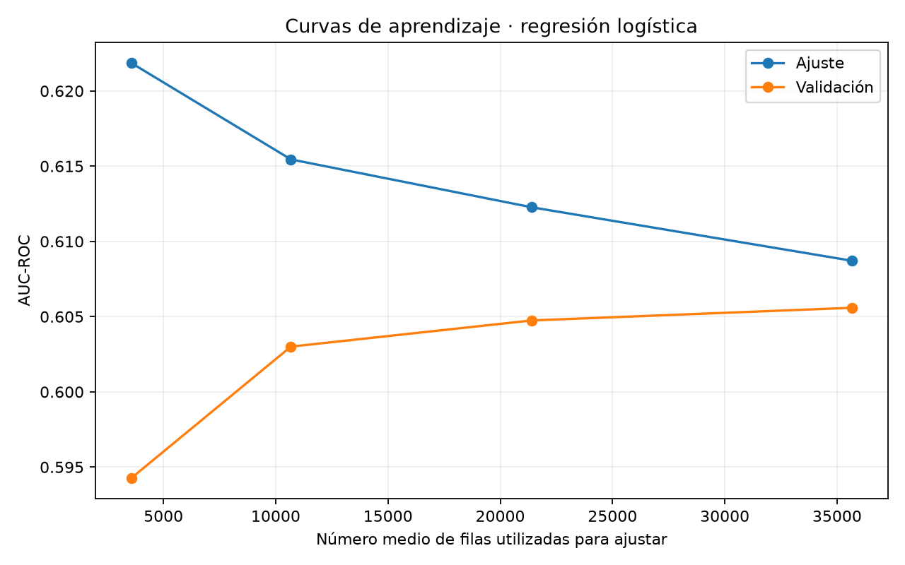

# Caries dental: revisión metodológica del 17 de octubre de 2026

Autor: Andrés Duarte Chaves · Docente: Dr. Lihki Rubio.

Esta revisión responde a la retroalimentación del primer entregable y actualiza el modelo base
del segundo. No sustituye el proyecto final ni añade otras familias de modelos al dashboard.
La versión originalmente evaluada permanece en el historial Git. Las cifras siguientes proceden
de la nueva ejecución; no se presentan como resultados de aquella entrega.

## Problema, procedencia y escenario

Se clasifica caries **registrada** en un chequeo; no incidencia futura ni diagnóstico clínico.
Se conservan 55,692 registros y 11,881 positivos (21.33%).
El archivo original adjunto y la copia usada coinciden en valores y orden de filas después de
normalizar smoking 0/1 a N/Y y las representaciones numéricas. Sus hashes de bytes son distintos.
Esto no verifica licencia, protocolo clínico ni independencia por paciente.

SHA-256 de la copia utilizada: `da697e1d194e6eeedbc643057a4e84f058496db61d0ee5574e212ce4aa102637`.
Ver `entregable_2/results/comparacion_csv_original.json` para la comparación documentada.
Fuente: [Body Signal of Smoking](https://www.kaggle.com/datasets/kucuro3/body-signal-of-smoking).

## Respuesta a las observaciones del profesor

| Observación | Corrección verificable |
|---|---|
| Faltaban categóricas | Conteos, proporciones, chi cuadrado y V de Cramer en entrenamiento |
| Sin corrección múltiple | Benjamini–Hochberg sobre los 23 contrastes de asociación |
| Sin atípicos multivariados | Isolation Forest exploratorio en entrenamiento; sin eliminar filas |
| Tártaro no disponible antes del examen | Exclusión explícita de tartar, además de ID y oral constante |
| Mecanismos clínicos atribuidos a efectos pequeños | Se reportan asociaciones y magnitudes, sin explicaciones causales |
| Escalado y MAR incoherentes | StandardScaler realmente ejecutado; no se presume MAR |
| Sin coeficientes ni CV | Coeficientes regularizados y cinco folds agrupados sin copias compartidas |

## Partición y preprocesamiento

Se agrupan perfiles de los **23 predictores finales**, excluyendo ID, oral, tartar y objetivo.
Un mismo perfil no cruza entrenamiento/prueba ni folds. Hay 44,582 filas train y
11,110 test. El EDA inferencial usa 35,641 perfiles únicos de entrenamiento
para no contabilizar copias como observaciones independientes; esto no demuestra independencia clínica.
Se conservan todas las filas en el ajuste y CV, con ponderación por fila consistente.

Género, tabaquismo, audición izquierda/derecha y proteína urinaria se codifican como categorías.
No se impone una distancia lineal entre códigos ordinales. El resto usa imputación por mediana
y StandardScaler; las categorías usan moda y OneHotEncoder. Cada fold ajusta sus transformaciones
sólo en entrenamiento. Hay 0 celdas vacías en el archivo: no se deduce mecanismo MAR.
Los extremos se conservan; el uso de StandardScaler no se denomina escalado robusto.

## EDA categórico

| variable       | category   |     n |   positive |   prevalence |
|:---------------|:-----------|------:|-----------:|-------------:|
| gender         | F          | 12971 |       2153 |      0.16599 |
| gender         | M          | 22670 |       5457 |      0.24071 |
| hearing(left)  | 1          | 34725 |       7446 |      0.21443 |
| hearing(left)  | 2          |   916 |        164 |      0.17904 |
| hearing(right) | 1          | 34730 |       7456 |      0.21468 |
| hearing(right) | 2          |   911 |        154 |      0.16905 |
| Urine protein  | 1          | 33675 |       7197 |      0.21372 |
| Urine protein  | 2          |  1140 |        241 |      0.21140 |
| Urine protein  | 3          |   592 |        124 |      0.20946 |
| Urine protein  | 4          |   171 |         39 |      0.22807 |
| Urine protein  | 5          |    55 |          7 |      0.12727 |
| Urine protein  | 6          |     8 |          2 |      0.25000 |
| smoking        | N          | 22592 |       4096 |      0.18130 |
| smoking        | Y          | 13049 |       3514 |      0.26929 |

Las proporciones dependen del tamaño de cada categoría. Una diferencia observada no implica causa.
Para celdas esperadas pequeñas, chi cuadrado es aproximado; no se usa como prueba clínica confirmatoria.

## Asociaciones y multiplicidad

| variable            | test         |       p |   effect | effect_name                    |   cells_expected_lt5 |    q_bh |
|:--------------------|:-------------|--------:|---------:|:-------------------------------|---------------------:|--------:|
| gender              | Chi cuadrado | 0.00000 |  0.08774 | V de Cramer                    |                    0 | 0.00000 |
| age                 | Mann Whitney | 0.00000 | -0.17382 | Correlación biserial de rangos |                    0 | 0.00000 |
| height(cm)          | Mann Whitney | 0.00000 |  0.11605 | Correlación biserial de rangos |                    0 | 0.00000 |
| weight(kg)          | Mann Whitney | 0.00000 |  0.10246 | Correlación biserial de rangos |                    0 | 0.00000 |
| waist(cm)           | Mann Whitney | 0.00000 |  0.05791 | Correlación biserial de rangos |                    0 | 0.00000 |
| eyesight(left)      | Mann Whitney | 0.00057 |  0.02535 | Correlación biserial de rangos |                    0 | 0.00082 |
| eyesight(right)     | Mann Whitney | 0.00000 |  0.03626 | Correlación biserial de rangos |                    0 | 0.00000 |
| hearing(left)       | Chi cuadrado | 0.00988 |  0.01367 | V de Cramer                    |                    0 | 0.01263 |
| hearing(right)      | Chi cuadrado | 0.00091 |  0.01758 | V de Cramer                    |                    0 | 0.00123 |
| systolic            | Mann Whitney | 0.00000 |  0.03721 | Correlación biserial de rangos |                    0 | 0.00000 |
| relaxation          | Mann Whitney | 0.00000 |  0.04018 | Correlación biserial de rangos |                    0 | 0.00000 |
| fasting blood sugar | Mann Whitney | 0.03351 |  0.01586 | Correlación biserial de rangos |                    0 | 0.03853 |
| Cholesterol         | Mann Whitney | 0.29491 | -0.00782 | Correlación biserial de rangos |                    0 | 0.30831 |
| triglyceride        | Mann Whitney | 0.00000 |  0.04395 | Correlación biserial de rangos |                    0 | 0.00000 |
| HDL                 | Mann Whitney | 0.00000 | -0.03619 | Correlación biserial de rangos |                    0 | 0.00000 |
| LDL                 | Mann Whitney | 0.13975 | -0.01102 | Correlación biserial de rangos |                    0 | 0.15306 |
| hemoglobin          | Mann Whitney | 0.00000 |  0.10308 | Correlación biserial de rangos |                    0 | 0.00000 |
| Urine protein       | Chi cuadrado | 0.72898 |  0.00888 | V de Cramer                    |                    1 | 0.72898 |
| serum creatinine    | Mann Whitney | 0.00000 |  0.05269 | Correlación biserial de rangos |                    0 | 0.00000 |
| AST                 | Mann Whitney | 0.01870 |  0.01753 | Correlación biserial de rangos |                    0 | 0.02263 |
| ALT                 | Mann Whitney | 0.00000 |  0.05244 | Correlación biserial de rangos |                    0 | 0.00000 |
| Gtp                 | Mann Whitney | 0.00000 |  0.08856 | Correlación biserial de rangos |                    0 | 0.00000 |
| smoking             | Chi cuadrado | 0.00000 |  0.10344 | V de Cramer                    |                    0 | 0.00000 |

Para continuas, el efecto es correlación biserial de rangos (positivo: valores mayores en positivos).
Para categorías se informa V de Cramer, sin signo. No son magnitudes intercambiables.
`q_bh` controla FDR bajo los supuestos del procedimiento; no es probabilidad de que una hipótesis sea cierta.
Un p o q pequeño con efecto pequeño no demuestra relevancia clínica. Las variables no se seleccionan
por estos contrastes ni se atribuyen mecanismos fisiológicos a asociaciones transversales.

## Atípicos multivariados

Isolation Forest identifica 1,782 de 35,641 perfiles de entrenamiento usando
contaminación prefijada del 5%. Este porcentaje es una decisión exploratoria, **no una estimación de
prevalencia de errores o enfermedad**. Se usa preprocesamiento ajustado sólo en entrenamiento.
No se elimina ninguna fila ni se usa este diagnóstico para modificar el test. Los scores e indicadores
están en `entregable_2/results/outliers.csv`. Requieren revisión de origen antes de cualquier exclusión.

## Modelo base y validación

Regresión logística L2, sin búsqueda de hiperparámetros. Cinco folds StratifiedGroupKFold:
AUC **0.60559 ± 0.00970** (media ± desviación estándar poblacional de folds,
no intervalo de confianza). Tanto CV como ajuste final usan todas las filas y la misma ponderación.
La CV de una familia fija no implica comparación exhaustiva ni validación externa.

| modelo   |   roc_auc |   average_precision |   accuracy |   precision |   recall |   specificity |      f1 |   brier |   tn |   fp |   fn |   tp |
|:---------|----------:|--------------------:|-----------:|------------:|---------:|--------------:|--------:|--------:|-----:|-----:|-----:|-----:|
| logistic |   0.60150 |             0.28421 |    0.78371 |     0.50000 |  0.00042 |       0.99989 | 0.00083 | 0.16597 | 8706 |    1 | 2402 |    1 |
| dummy    |   0.50000 |             0.21629 |    0.78371 |     0.00000 |  0.00000 |       1.00000 | 0.00000 | 0.16952 | 8707 |    0 | 2403 |    0 |

AUC test 0.60150 y AP 0.28421 muestran una
señal limitada. La referencia AP es la prevalencia de prueba 0.21629.
A umbral 0,5: TP=1, FN=2402, TN=8706, FP=1.
Por tanto, la exactitud elevada oculta que casi todos los positivos se pierden. No se recomienda
este umbral para un uso clínico. El slider es retrospectivo y no selecciona cortes en test.
El Brier describe error probabilístico; la curva de calibración no demuestra transportabilidad.

## Coeficientes e interpretación

| feature                  |   coefficient |   exp_coefficient |
|:-------------------------|--------------:|------------------:|
| num__age                 |      -0.32169 |           0.72492 |
| num__height(cm)          |      -0.06409 |           0.93792 |
| num__weight(kg)          |      -0.00107 |           0.99893 |
| num__waist(cm)           |       0.03290 |           1.03345 |
| num__eyesight(left)      |      -0.09056 |           0.91342 |
| num__eyesight(right)     |       0.00228 |           1.00228 |
| num__systolic            |       0.06629 |           1.06854 |
| num__relaxation          |       0.00072 |           1.00072 |
| num__fasting blood sugar |       0.01400 |           1.01410 |
| num__Cholesterol         |       0.02229 |           1.02254 |
| num__triglyceride        |      -0.02313 |           0.97714 |
| num__HDL                 |      -0.01990 |           0.98029 |
| num__LDL                 |      -0.00001 |           0.99999 |
| num__hemoglobin          |      -0.04349 |           0.95744 |
| num__serum creatinine    |      -0.03388 |           0.96669 |
| num__AST                 |      -0.00169 |           0.99831 |
| num__ALT                 |       0.00228 |           1.00228 |
| num__Gtp                 |       0.05058 |           1.05188 |
| cat__gender_F            |      -0.31133 |           0.73247 |
| cat__gender_M            |      -0.11532 |           0.89109 |
| cat__smoking_N           |      -0.39817 |           0.67155 |
| cat__smoking_Y           |      -0.02847 |           0.97193 |
| cat__hearing(left)_1     |      -0.23091 |           0.79381 |
| cat__hearing(left)_2     |      -0.19573 |           0.82223 |
| cat__hearing(right)_1    |      -0.24289 |           0.78436 |
| cat__hearing(right)_2    |      -0.18375 |           0.83214 |
| cat__Urine protein_1     |       0.03046 |           1.03092 |
| cat__Urine protein_2     |       0.04478 |           1.04580 |
| cat__Urine protein_3     |       0.09068 |           1.09492 |
| cat__Urine protein_4     |      -0.01140 |           0.98867 |
| cat__Urine protein_5     |      -0.57430 |           0.56310 |
| cat__Urine protein_6     |      -0.00686 |           0.99316 |

Los coeficientes numéricos corresponden a una desviación estándar de entrenamiento, manteniendo
los demás términos fijos. Son asociaciones ajustadas de un modelo penalizado, no efectos causales.
Para una variable continua, exp(coeficiente) es el multiplicador de odds por esa unidad estandarizada.
OneHotEncoder conserva todas las categorías: **exp(coeficiente) de una categoría no es por sí solo
un odds ratio frente a una categoría de referencia**. La comparación A vs B usa exp(beta_A-beta_B).
No se reportan intervalos ni significación inferencial de coeficientes regularizados.

## Descriptivos univariados y extremos

| variable            |       count |      mean |      std |       min |       25% |       50% |       75% |        max |      IQR |     skew |   tukey_count |
|:--------------------|------------:|----------:|---------:|----------:|----------:|----------:|----------:|-----------:|---------:|---------:|--------------:|
| age                 | 35641.00000 |  44.22309 | 12.10995 |  20.00000 |  40.00000 |  40.00000 |  55.00000 |   85.00000 | 15.00000 |  0.26731 |           207 |
| height(cm)          | 35641.00000 | 164.65335 |  9.21999 | 135.00000 | 160.00000 | 165.00000 | 170.00000 |  190.00000 | 10.00000 | -0.13951 |           163 |
| weight(kg)          | 35641.00000 |  65.86838 | 12.81262 |  30.00000 |  55.00000 |  65.00000 |  75.00000 |  135.00000 | 20.00000 |  0.53368 |           126 |
| waist(cm)           | 35641.00000 |  82.06580 |  9.26351 |  51.00000 |  76.00000 |  82.00000 |  88.00000 |  129.00000 | 12.00000 |  0.24561 |           323 |
| eyesight(left)      | 35641.00000 |   1.01143 |  0.47861 |   0.10000 |   0.80000 |   1.00000 |   1.20000 |    9.90000 |  0.40000 |  9.81994 |           861 |
| eyesight(right)     | 35641.00000 |   1.00770 |  0.48012 |   0.10000 |   0.80000 |   1.00000 |   1.20000 |    9.90000 |  0.40000 |  9.91403 |           859 |
| systolic            | 35641.00000 | 121.48801 | 13.62897 |  71.00000 | 112.00000 | 120.00000 | 130.00000 |  240.00000 | 18.00000 |  0.45164 |           412 |
| relaxation          | 35641.00000 |  76.03272 |  9.65276 |  40.00000 |  70.00000 |  76.00000 |  82.00000 |  146.00000 | 12.00000 |  0.37635 |           424 |
| fasting blood sugar | 35641.00000 |  99.24057 | 20.84189 |  46.00000 |  89.00000 |  96.00000 | 104.00000 |  505.00000 | 15.00000 |  4.60151 |          2096 |
| Cholesterol         | 35641.00000 | 197.02792 | 36.45416 |  72.00000 | 172.00000 | 195.00000 | 220.00000 |  445.00000 | 48.00000 |  0.39679 |           395 |
| triglyceride        | 35641.00000 | 126.48427 | 71.71541 |   8.00000 |  74.00000 | 108.00000 | 160.00000 |  999.00000 | 86.00000 |  1.33356 |          1448 |
| HDL                 | 35641.00000 |  57.29155 | 14.85274 |   4.00000 |  47.00000 |  55.00000 |  66.00000 |  618.00000 | 19.00000 |  2.53609 |           633 |
| LDL                 | 35641.00000 | 115.14960 | 41.96147 |   1.00000 |  92.00000 | 113.00000 | 136.00000 | 1860.00000 | 44.00000 | 11.89359 |           409 |
| hemoglobin          | 35641.00000 |  14.61901 |  1.55888 |   4.90000 |  13.60000 |  14.80000 |  15.70000 |   21.10000 |  2.10000 | -0.65729 |           485 |
| serum creatinine    | 35641.00000 |   0.88605 |  0.23294 |   0.10000 |   0.80000 |   0.90000 |   1.00000 |   11.60000 |  0.20000 | 11.87337 |          2032 |
| AST                 | 35641.00000 |  26.16366 | 18.38056 |   7.00000 |  19.00000 |  23.00000 |  29.00000 | 1311.00000 | 10.00000 | 24.61425 |          1898 |
| ALT                 | 35641.00000 |  27.07828 | 32.63893 |   1.00000 |  15.00000 |  21.00000 |  31.00000 | 2914.00000 | 16.00000 | 39.23060 |          2390 |
| Gtp                 | 35641.00000 |  39.84972 | 50.06300 |   1.00000 |  17.00000 |  26.00000 |  43.00000 |  999.00000 | 26.00000 |  6.71751 |          3178 |

Tukey es una regla descriptiva; sus extremos no se eliminan automáticamente. Asimetría no demuestra enfermedad ni mecanismo clínico.

Contraste cat__gender_F frente a cat__gender_M: OR ajustado descriptivo **0.822**.

Contraste cat__smoking_N frente a cat__smoking_Y: OR ajustado descriptivo **0.691**.

## Límites y comparación histórica

La cifra anterior AUC 0,6441 procede de otro escenario y partición; no se interpreta como
reproducción de este experimento ni se atribuye la diferencia únicamente a excluir tártaro.
Un AUC univariado bajo no descarta fuga: importan origen y disponibilidad temporal de cada predictor.
El test es interno y la base se ha usado anteriormente. No existe validación externa ni confirmación
de representatividad colombiana, independencia por persona o protocolo diagnóstico del origen.

## Reproducción

Desde la raíz del repositorio:

```bash
pip install -r requirements_nuevas.txt
python -m entregable_2.train
python -m entregable_2.audit
python build_new_book.py
python -m pytest -q
```

## Gráficos del dashboard
```{raw} html
<iframe src="_static/revision_contexto_0.html" width="100%" height="550" style="border:0" title="revision_contexto_0"></iframe>
```
```{raw} html
<iframe src="_static/revision_modelo_0.html" width="100%" height="550" style="border:0" title="revision_modelo_0"></iframe>
```
```{raw} html
<iframe src="_static/revision_modelo_1.html" width="100%" height="550" style="border:0" title="revision_modelo_1"></iframe>
```
```{raw} html
<iframe src="_static/revision_modelo_2.html" width="100%" height="550" style="border:0" title="revision_modelo_2"></iframe>
```
```{raw} html
<iframe src="_static/revision_eda_0.html" width="100%" height="550" style="border:0" title="revision_eda_0"></iframe>
```
```{raw} html
<iframe src="_static/revision_eda_1.html" width="100%" height="550" style="border:0" title="revision_eda_1"></iframe>
```
```{raw} html
<iframe src="_static/revision_eda_2.html" width="100%" height="550" style="border:0" title="revision_eda_2"></iframe>
```
```{raw} html
<iframe src="_static/revision_eda_3.html" width="100%" height="550" style="border:0" title="revision_eda_3"></iframe>
```
```{raw} html
<iframe src="_static/revision_eda_4.html" width="100%" height="550" style="border:0" title="revision_eda_4"></iframe>
```
```{raw} html
<iframe src="_static/revision_eda_5.html" width="100%" height="550" style="border:0" title="revision_eda_5"></iframe>
```
```{raw} html
<iframe src="_static/revision_edad_0.html" width="100%" height="550" style="border:0" title="revision_edad_0"></iframe>
```
```{raw} html
<iframe src="_static/revision_edad_1.html" width="100%" height="550" style="border:0" title="revision_edad_1"></iframe>
```
```{raw} html
<iframe src="_static/revision_edad_2.html" width="100%" height="550" style="border:0" title="revision_edad_2"></iframe>
```


## Incertidumbre del AUC del modelo base

La regresión logística conservada obtuvo un AUC-ROC de
**0.601501**, con **intervalo de confianza del 95 %
[0.586214, 0.616684]**.

Se utilizaron 2.000 réplicas de bootstrap percentil, estratificadas por
clase y agrupadas por los perfiles de los 23 predictores finales,
con semilla 42. El test contiene 11.110 filas y 8.911 perfiles.
Al remuestrear un perfil se mantienen juntas sus filas; el AUC conserva
la ponderación por fila y las puntuaciones originales.

Este intervalo cuantifica incertidumbre de evaluación condicionada al
modelo ya ajustado. Supone independencia entre perfiles, que no equivale
a independencia verificada por paciente. No incorpora variabilidad del
entrenamiento ni constituye validación externa. No es un intervalo de
predicción individual ni la desviación estándar entre folds.

El resultado muestra capacidad discriminativa limitada. Debe interpretarse
junto con sensibilidad, especificidad, precisión, matriz de confusión y
calibración. No valida un uso clínico ni demuestra una contribución original.
El conjunto de prueba ya consultado debe documentarse como tal al diseñar
el proyecto final.

Evidencia reproducible en el repositorio:
`entregable_2/results/incertidumbre_20261018_195728_740445/auc_ic95.json`.


## Curvas de aprendizaje del modelo base



| Perfiles utilizados | Filas medias de ajuste | AUC ajuste | AUC validación | DE entre folds |
|---|---:|---:|---:|---:|
| 10% | 3566.8 | 0.6219 | 0.5943 | 0.0117 |
| 30% | 10677.4 | 0.6155 | 0.6030 | 0.0114 |
| 60% | 21398.0 | 0.6123 | 0.6047 | 0.0110 |
| 100% | 35665.6 | 0.6087 | 0.6056 | 0.0108 |


Se conservaron los cinco folds de validación agrupada. Dentro de cada
conjunto de ajuste se seleccionaron subconjuntos anidados de perfiles,
estratificados por clase, manteniendo juntas todas sus copias.
Las transformaciones se aprendieron exclusivamente en cada subconjunto.
El punto del 100 % reutiliza los resultados de la validación cruzada
original. Los tamaños corresponden a la porción de ajuste de cada fold,
no al conjunto de entrenamiento completo.

El AUC medio de validación aumenta de 0,5943 a 0,6056, mientras la
diferencia entre ajuste y validación disminuye aproximadamente de
0,0276 a 0,0031. Entre el 60 % y el 100 %, el incremento de validación
es aproximadamente 0,0008. El patrón sugiere rendimientos decrecientes
al añadir datos para esta especificación de regresión logística.
No constituye una prueba de equivalencia, un techo universal de
predicción ni evidencia de superioridad de un modelo alternativo.

La DE presentada es la desviación estándar muestral entre cinco folds
(ddof=1); no representa un intervalo de confianza del 95 %.
Puede diferir de resúmenes anteriores calculados con ddof=0.
Las medias de validación mantienen ponderación igual por fold.
Este diagnóstico no utiliza el test para evaluar las curvas ni
modifica el modelo final, sus hiperparámetros o su umbral.

[Descargar resultados por fold](_static/caries_curvas_aprendizaje/curvas.csv)
· [Consultar método](_static/caries_curvas_aprendizaje/metodo.json)


## Diccionario operativo de variables

Este diccionario documenta el tratamiento efectivamente utilizado.
Las unidades clínicas, escalas y categorías marcadas como pendientes
no han sido confirmadas mediante el diccionario original del productor.
Las denominaciones traducidas no sustituyen esa verificación.

| Variable | Significado | Tipo | Unidad o codificación | Tratamiento |
|---|---|---|---|---|
| gender | Sexo registrado | Nominal binaria | F/M; etiquetas del archivo | Moda + one-hot dentro de cada ajuste |
| age | Edad registrada | Cuantitativa discretizada | Unidad y regla de agrupación pendientes de confirmar | Mediana + estandarización dentro de cada ajuste |
| height(cm) | Estatura | Continua registrada con resolución limitada | cm, según encabezado | Mediana + estandarización dentro de cada ajuste |
| weight(kg) | Peso corporal | Continua registrada con resolución limitada | kg, según encabezado | Mediana + estandarización dentro de cada ajuste |
| waist(cm) | Perímetro de cintura | Continua | cm, según encabezado | Mediana + estandarización dentro de cada ajuste |
| eyesight(left) | Agudeza visual izquierda | Cuantitativa; escala por confirmar | Escala y códigos especiales pendientes | Mediana + estandarización dentro de cada ajuste |
| eyesight(right) | Agudeza visual derecha | Cuantitativa; escala por confirmar | Escala y códigos especiales pendientes | Mediana + estandarización dentro de cada ajuste |
| hearing(left) | Código de audición izquierda | Categórica binaria | Significado clínico de los códigos pendiente | Moda + one-hot dentro de cada ajuste |
| hearing(right) | Código de audición derecha | Categórica binaria | Significado clínico de los códigos pendiente | Moda + one-hot dentro de cada ajuste |
| systolic | Presión arterial sistólica | Continua | Unidad original pendiente de confirmar | Mediana + estandarización dentro de cada ajuste |
| relaxation | Presión diastólica: interpretación del campo por confirmar | Continua | Definición y unidad pendientes de confirmar | Mediana + estandarización dentro de cada ajuste |
| fasting blood sugar | Glucosa en ayunas | Continua | Unidad original pendiente de confirmar | Mediana + estandarización dentro de cada ajuste |
| Cholesterol | Colesterol total | Continua | Unidad original pendiente de confirmar | Mediana + estandarización dentro de cada ajuste |
| triglyceride | Triglicéridos | Continua | Unidad original pendiente de confirmar | Mediana + estandarización dentro de cada ajuste |
| HDL | Colesterol HDL | Continua | Unidad original pendiente de confirmar | Mediana + estandarización dentro de cada ajuste |
| LDL | Colesterol LDL | Continua | Unidad original pendiente de confirmar | Mediana + estandarización dentro de cada ajuste |
| hemoglobin | Hemoglobina | Continua | Unidad original pendiente de confirmar | Mediana + estandarización dentro de cada ajuste |
| Urine protein | Código de proteína urinaria | Categórica; ordinalidad por confirmar | No se presuponen distancias iguales entre códigos | Moda + one-hot dentro de cada ajuste |
| serum creatinine | Creatinina sérica | Continua | Unidad original pendiente de confirmar | Mediana + estandarización dentro de cada ajuste |
| AST | Aspartato aminotransferasa | Continua | Unidad original pendiente de confirmar | Mediana + estandarización dentro de cada ajuste |
| ALT | Alanina aminotransferasa | Continua | Unidad original pendiente de confirmar | Mediana + estandarización dentro de cada ajuste |
| Gtp | Gamma-glutamiltransferasa: denominación por confirmar | Continua | Unidad original pendiente de confirmar | Mediana + estandarización dentro de cada ajuste |
| smoking | Estado de tabaquismo registrado | Binaria | N/Y; copia original 0/1 normalizada, sin detalle temporal | Moda + one-hot dentro de cada ajuste |
| dental caries | Caries registrada | Binaria | 0: ausencia registrada; 1: presencia registrada | Objetivo; no entra como predictor |
| ID | Identificador de fila | Nominal identificadora | No acredita identidad longitudinal de una persona | Excluido: identificador |
| oral | Código de examen oral | Nominal constante en la base revisada | Significado detallado pendiente | Excluido: constante |
| tartar | Registro de cálculo dental | Binaria | Requiere información de exploración oral | Excluido: disponibilidad previa al examen no justificada |


[Descargar diccionario y valores observados en entrenamiento](_static/caries_diccionario/diccionario.csv)

**Criterios de codificación.** Un código numérico no convierte una categoría
en una magnitud. Audición y proteína urinaria se representan mediante
one-hot, sin imponer distancias iguales. La edad se utiliza en su escala
numérica registrada; no se crean nuevos intervalos arbitrarios. La
interpretación de un coeficiente estandarizado corresponde a una
desviación estándar del entrenamiento, no a una unidad clínica original.

**Límites de interpretación.** Los rangos observados no son intervalos de
referencia clínica ni intervalos de confianza. No se recodifican posibles
valores centinela —por ejemplo, extremos de agudeza visual— sin documentación.
Los análisis de laboratorio sólo serían utilizables en un escenario en que
ya estuvieran disponibles antes de la decisión odontológica; esa secuencia
no está acreditada por esta base transversal.

**Pendientes de procedencia.** Confirmar unidades, códigos especiales,
definición diagnóstica de caries, protocolo de recogida y licencia aplicable.
No se presenta este diccionario operativo como un codebook clínico validado.
